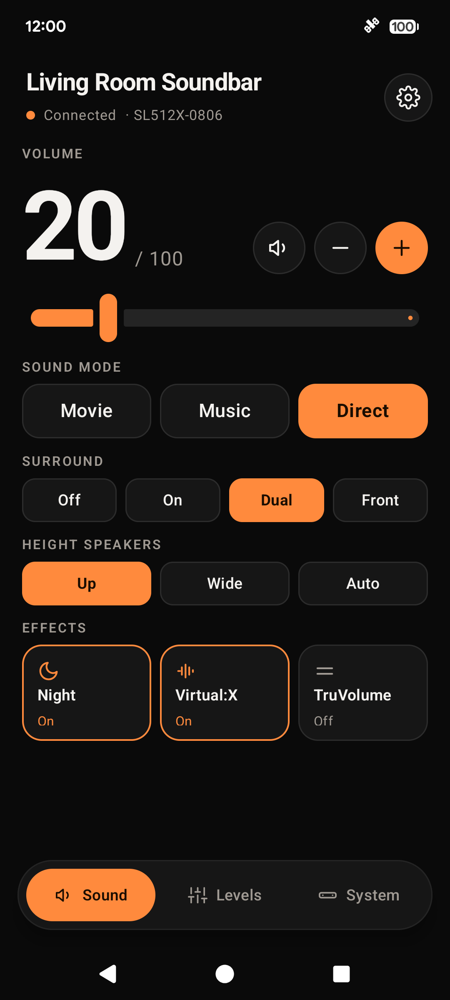
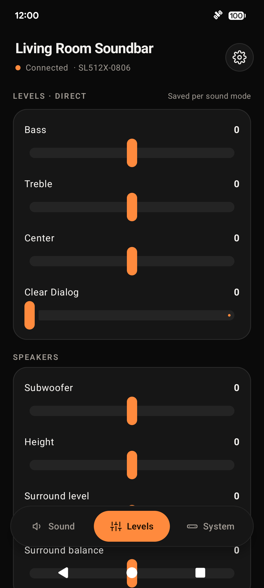
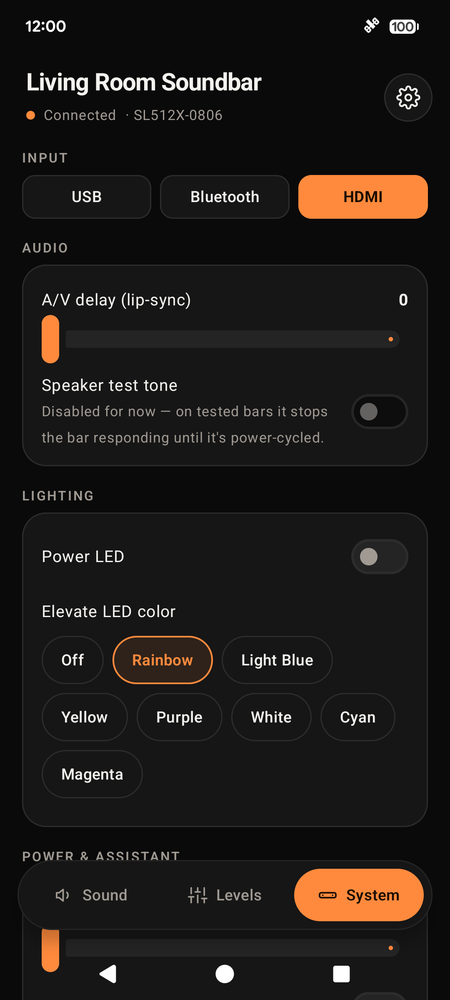
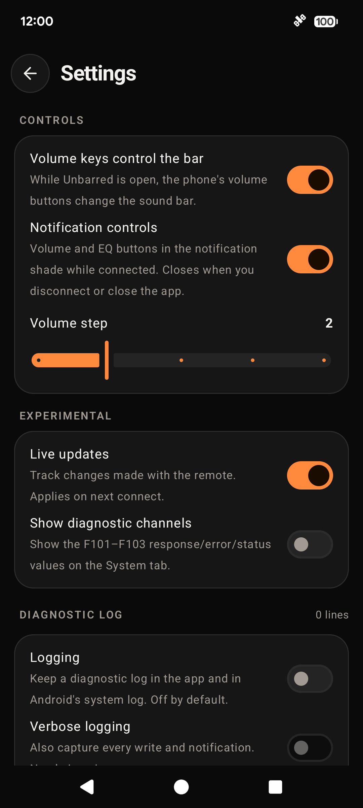
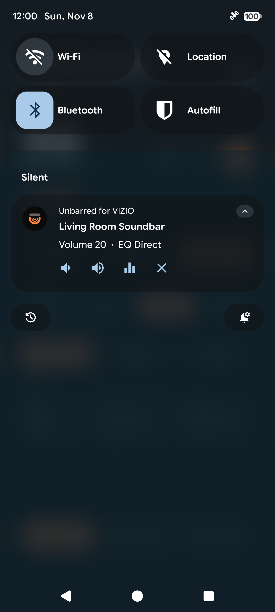

# Unbarred — an open BLE client for VIZIO soundbars

**An independent, open-source controller for VIZIO Bluetooth-LE soundbars
(Elevate SE / SL512X and relatives).** No account, no login, no cloud — it talks
to the bar directly over Bluetooth using the device's own GATT protocol, which was
reverse engineered by its developer, with AI assistance, for interoperability
(see [How the protocol was derived](DISCLAIMER.md#how-the-protocol-was-derived)).

> ⚖️ **Not affiliated with VIZIO.** This is an independent interoperability /
> right-to-repair project. "VIZIO" is a trademark of its owner, used here only to
> describe which hardware this software works with. See [DISCLAIMER.md](DISCLAIMER.md).

<p align="center">
  
  &nbsp;
  
  &nbsp;
  
  <!-- &nbsp;<br><br>
  
  &nbsp;
   -->
</p>
<p align="center"><sub>Sound · Levels · System</sub></p>

---

## Why this exists

Some of these soundbars can only be configured through the vendor's mobile app —
EQ presets, the 5.1/surround toggle, the Elevate height-speaker aim, LED color,
ClearDialog and the rest live behind that app and an account login. When the app
breaks, stops being maintained, changes its sign-in, or you simply don't want a
cloud account to adjust hardware you already own, those settings become
unreachable even though the speaker itself is perfectly fine.

This project restores that control. It implements the **same local Bluetooth
protocol the app uses** — including the on-device authentication handshake — so you
can keep using every feature of a speaker you paid for, from software you can read,
audit, and change.

This is a **right-to-repair / interoperability** effort in the classic sense:
observing how a device you own communicates, and writing a compatible client for it.

## What's in the repo

| Path | What it is |
|---|---|
| **`app/`** | Android app (Kotlin + Jetpack Compose) — the recommended client; runs on a phone, where BLE "just works". |
| **`python/`** | Cross-platform command-line controller (`bleak`) for PC / Raspberry Pi / anything with a working BLE radio. |
| **[`PROTOCOL.md`](PROTOCOL.md)** | Full documentation of the BLE GATT protocol: services, characteristics, value encodings, and the local auth handshake. |
| **[`DISCLAIMER.md`](DISCLAIMER.md)** | Trademark, affiliation, warranty and legal notes. |
| **[`CONTRIBUTING.md`](CONTRIBUTING.md)** | How to help, and how to add support for other models. |

## Features

Everything the vendor app exposes for audio, effects and system settings:

- **Sound modes** — EQ preset (Movie / Music / Direct), surround / 5.1 mode, Elevate height-speaker aim (Up / Wide / Auto)
- **Levels** — volume, bass, treble, center, **ClearDialog**, subwoofer, height, surround level & balance, wide-surround level & balance
- **Effects** — Night mode, Virtual:X, TruVolume, mute
- **System** — input select, A/V (lip-sync) delay, power-LED brightness, eco power, Auto-HDMI, voice-assistant toggle, spoken announcements (speaker test is disabled for now: it leaves the bar unresponsive until power-cycled)
- **LED** — Elevate LED color (8 colors)
- **Status** — model / serial / firmware, current input, current audio format, wireless-speaker link status

Deliberately **not** included: factory reset and firmware OTA (dangerous), and the
karaoke/mic features (MicMe-only). See the safety notes in `PROTOCOL.md`.

### Android app highlights

The Android client does more than send one-shot commands:

- **Live state, not guesses** — on connect it reads every control's current value, and
  subscribes to the bar's notifications. Sliders and toggles show what the bar is
  *actually* set to, and **follow changes you make with the IR remote or buttons** in
  real time. (The vendor app never subscribes to notifications; this one does.)
- **Per-EQ-mode levels, handled correctly** — the bar stores a separate set of channel
  trims for each EQ preset. Switch Movie → Music and the level sliders update to that
  mode's values automatically. (See §8 of `PROTOCOL.md` for why.)
- **Multiple bars** — if more than one bar is in range, a picker lets you choose; assign
  a custom name to tell identical units apart.
- **Reliable writes** — adaptive Write-Without-Response plus a coalescing, rate-limited
  queue eliminates the firmware's spurious `status 14` errors during slider drags, and
  the local auth handshake retries transient first-connect timeouts.
- **Volume keys** — while the app is open, the phone's volume buttons adjust the bar
  (configurable step; can be turned off).
- **Notification controls** — volume −/+, EQ cycle and disconnect from the notification shade
  while connected; tap it to reopen the app. It closes when you disconnect or close the app.
- **Clear connection progress** — scanning → connecting → authenticating → syncing, with
  controls locked until the bar's real values have been read.
- **Settings & diagnostics** — saved between launches: an in-app log with one-tap
  share/export (logging is off by default; one switch turns all of it on), a verbose-logging
  toggle, a live-updates toggle, and an optional view of the
  raw response/error/status channels — handy for filing issues or bringing up a new model.
- **On-demand update check** — checks GitHub Releases for a newer build (no background
  polling, no auto-install).
- **First-run disclaimer** — a one-time trademark / non-affiliation / no-warranty notice.

## How it works (short version)

- The bar exposes a set of custom 128-bit GATT services. Each setting is a single
  byte written to its own characteristic.
- If the bar advertises a security service, writes are authenticated with a short
  token obtained by a **local** handshake: the client sends a fixed device id and a
  fixed response, and the bar hands back a session token — **no server and no account
  are involved**. Full details are in [`PROTOCOL.md`](PROTOCOL.md).
- Nothing in this project talks to any VIZIO or Walmart server.

## Quick start — Android app

1. Open the project root in **Android Studio**, let Gradle sync.
2. Enable USB debugging on an Android phone (BLE needs a real device, not an emulator), plug it in.
3. Press **Run ▶**. Grant the Bluetooth permission, tap **Scan & Connect**.
4. Once it shows *Authenticated ✓ ready*, use the controls.

For a shareable file: **Build → Build APK(s)** → `app/build/outputs/apk/debug/app-debug.apk`.

## Quick start — Python CLI

```bash
cd python
pip install bleak
python vizio_soundbar.py scan                 # find the bar's address
python vizio_soundbar.py -a <ADDRESS> services   # connect + handshake + list GATT
python vizio_soundbar.py -a <ADDRESS> eq music
python vizio_soundbar.py -a <ADDRESS> led cyan
```

See [`python/README.md`](python/README.md) for the full command list and
troubleshooting (including the "my PC's Bluetooth radio won't scan" case — run it
on a phone/Pi, or use a known-good USB BLE dongle).

## Compatibility

Developed and confirmed against the **VIZIO Elevate SE (SL512X)**. The protocol is
shared across this generation of VIZIO BLE bars, so other models very likely work —
the handshake and most characteristics are common, and absent features simply won't
appear. If you try another model, please open an issue with the output of
`python vizio_soundbar.py -a <ADDRESS> services` so we can record what it exposes.

## Safety

These are just settings on your own speaker, and the bar clamps out-of-range values —
normal use is low-risk. The two things to avoid are **factory reset** and the
**OTA/firmware** characteristics; this project keeps both out of the convenience
controls for that reason. Don't write to characteristics you haven't identified.

## License

[MIT](LICENSE). See [DISCLAIMER.md](DISCLAIMER.md) for trademark, affiliation and
warranty notes — please read it before using or redistributing.

## Acknowledgements

Built by and for owners who believe you should be able to keep using the hardware you
bought. Developed by a single owner of the hardware, with AI tools used for the protocol
analysis, authentication reverse engineering, and Bluetooth packet-capture work.
